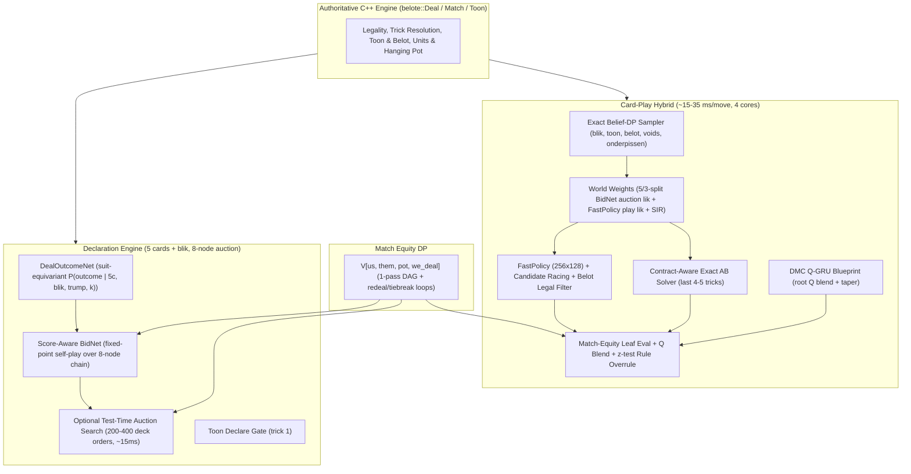

# Belgian Belote Bot — Architecture & Training Plan

A concrete blueprint for building a strong **Belgian Belote** bot on top of the C++ rules engine in [`cpp/belote/`](cpp/belote/), adapting the proven **Manille `v1.2.3`** stack ([manil-bot](https://github.com/frigoow/manil-bot): DMC Q-GRU + exact Belief-DP world sampling + `FastPolicy` play-outs + exact Match-Equity decision layer) and incorporating empirical lessons from the Belote research snapshot ([State of Belote bots](reports/State%20of%20Belote%20bots.md), [Belote bot results](reports/Belote%20bot%20results.md)).

---

## 1. What Transfers from Manille vs. What Genuinely Changes

Card play transfers almost directly from Manille — and is actually *simpler* in one major way (suit-only contracts, no *mull* / no-trump mode, and no doubling). By contrast, **scoring and declarations introduce two deep structural changes**:

| Dimension | Manille (`v1.2.3`) | Belgian Belote ([RULES.md](RULES.md)) | Plan impact |
|---|---|---|---|
| **Game modes** | Suit + *Mull* (2 model families) | Suit-only (no SA/TA, no doubling) | **Half the card-play models & training compute** |
| **Deal reward** | Linear zero-sum (`pts − 30`) | **Non-linear contract cliff**: Made (`T > D`), *Nat* (`0` vs `162 + toon`), *Hanging* (*op den boek*), *Ronde* (`252`) | Q-net, rollouts, and endgame AB **must** be contract- & score-aware |
| **Hard card constraints** | Voids, trump upper bound, optional declarer filter | **`blik` pinned to taker**, **shown `toon` cards pinned at trick 3**, voids, **`must_undertrump` → exact trump void**, trump upper bound (and *no* side-suit beat obligation) | Sharper Belief-DP world sampling; exact enumeration arrives earlier |
| **Belot / Rebelot** | None | K+Q of trump = 20 pts (inviolable even on *nat*); either card may come first under [BR] (`wikibooks()`: Q before K forfeits 20) | Rollout net, rule play-out, Q features, and AB solver must track Belot state |
| **Bidding / Declaration** | 8 cards known → 1-step trump/mull + knock/terug | **5 cards + `blik` + 3 unknown cards**, **2-round 8-seat sequential auction** (`Pass` continues, `Take`/`Choose` ends), plus trick-1 optional `toon` | Dedicated sequential auction solver (`DealOutcomeNet` + score-aware `BidNet` + optional auction search) |
| **Match scoring** | Single scorer per deal, 101 target | **Both teams score on Made**: defenders rounded to units (`75 → 8`), takers get the rest of 16 + bonuses (`recordDeal`), **hanging pot** accumulates, 101 with a **2-unit lead** | 1-pass DAG `V[us, them, pot, we_deal]` (exact for fixed policies; grid-approximated once bidding/play are score-aware) |

### Key Empirical Lessons Carried Over
- **From Manille `v1.2.3`:**
  - *Keep*: DMC action-as-input Q-GRU blueprint (no search teacher during training), exact belief-weighted DP world sampling, `256×128` distilled `FastPolicy` play-outs, candidate racing (`K0 = 192, z = 2.5`), late-deal Q-blend taper, suit-symmetrized declaration oracles, and **refitting card play on the real bidder's deal distribution** (`+0.73 pts/deal` on Manille mull).
  - *Skip*: Wider `FastPolicy` nets (`384×192`+), naive self-play policy iteration v2, adaptive extra worlds, and ExIt/search-distillation training.
- **From Kostov (`BelotGameEngine`), Pemeja, Colver, and Kermit:**
  - Pure self-play bidding can invent private relays that hurt human/conventional partners (in Bulgarian mixed-partner tests, natural-bidding Master beat relay-bidding Master **64.78% ± 0.64 pp** vs 50% when each was paired with Belot 2.06; [Belote bot results](reports/Belote%20bot%20results.md#L14)). Gate bidding on **mixed-partner matches** from day 1.
  - Optimizing **match win probability** beats optimizing raw deal points (Colver Bid V6 beat V5 by **57.3% wins and +181 pts/match** in paired 2,000-point matches with IS-DD card play, even while its standalone per-deal audit reported **−22 pts/deal** vs V5; [methods.md](research_notes/State%20of%20Belote%20bots/methods.md#L43)).
  - **Contract-aware exact double-dummy alpha-beta** in the last 4–5 tricks is a large lever in Belote because of the *nat* cliff, but must be A/B tested against rollouts at equal wall-clock due to strategy fusion.

---

## 2. System Architecture Overview



---

## 3. Card Play Design (Adapting Manille `v1.2.3`)

Card play keeps the proven Manille pipeline — **DMC blueprint → Belief net → FastPolicy → C++ Belief-DP + Racing + Q-blend** — with **five Belote-specific modifications** built in from day 1:

### 3.1 Contract-Aware Reward & Features (The *Nat* Cliff)
- **Why linear card points fail:** Going from 80 to 82 card points as takers is a **164-point swing** (`0–162` vs `82–80`), and sweeping all 8 tricks (*Ronde*) jumps to `252` and voids opponent toons.
- **DMC training target:** Realized deal recorded unit difference (`recordDeal(result, cfg).scores`, so the complement rounding is exactly the engine's):
  $$r = \frac{\text{rec}_{\text{us}} - \text{rec}_{\text{them}}}{25}$$
  On `Outcome::kHanging`, defenders score their recorded units and the held-over pot is left at neutral 50/50 expectation (`0` net advantage during deal-only training), preserving the exact contract cliff and *ronde* bonus while staying well-scaled.
- **Mandatory card-play observation features (golden-tested C++ == Python):**
  - Own hand (`32`), per-seat played cards (`4 × 32`), exact void flags (`4 × 4`), upper-trump-bound per seat (`4 × 8`, tracking failed overtrumps).
  - Contract & auction context: trump suit (`4`), relative taker seat (`4`), `is_taker_team` (`1`), `blik` card (`32` + `blik_still_in_taker_hand` flag), auction round (`R1`/`R2`) + pass count (`8`).
  - **Declaration state:** trick-1 announcement per seat from `Deal::announcement(p)` (`4 × 5`: none/derde/vierde/vijfde/carré, plus the carré rank `4 × 6`), trick-3 shown toon cards (`4 × 32`; only the team with the best toon shows, so "who shows" also tells who won the comparison), resolved `toon_team` & `toon_points` (`2`), Belot state (`has_intact_KQ`, `one_of_KQ_played_other_held`, `belot_scored_by_team[2]`; plus `belot_forfeited` only under `belot_queen_first_forfeits`).
  - **Contract-cliff scalars:** banked card points (`us`, `them`), tricks won (`us`, `them`, for *ronde* threat), and explicit **points-needed-to-make** (`takers_needed = max(0, target - takers_total)`).
  - Per-ply ordered history with **legal-context bits** (`could_follow`, `could_trump`, `could_overtrump`, `forced_undertrump`, `n_legal`) — start with an MLP baseline for M0/M1 sanity, then upgrade to **Q-GRU** (using the same gated diagnostics D1–D4 from Manille).

### 3.2 Hard-Constraint Belief-DP World Sampler
Port Manille's bottom-up exact Belief-DP sampler with Belote's sharper public constraints:
1. **Hard-pinned hidden cards & Belot/Toon hard constraints:**
   - `blik` is pinned to `taker` until played.
   - At trick 3, every unplayed card in a shown `toon` is pinned to its declarer.
   - **Belot announcements:** under [BR] "belot" is said with whichever of trump K/Q the holder plays first. When it is announced (`belotAnnounced() == true`), the other card is **hard-pinned** to that player; if a player plays trump K or Q with **no** announcement while the other is still unplayed, that player **cannot hold it** (hard exclusion). Under `wikibooks()` only the K triggers the announcement, so a Q played first says nothing.
   - **Trick-1 announcement is a hard constraint** (between tricks 1 and 3): the engine only announces genuine toons, so reject any world where an announcing seat's 8-card hand doesn't have that best toon (kind, carré rank). At trick 3, a non-showing announcer is on the losing side of the comparison, which is a further hard constraint on their best toon. Only *not* announcing is soft, since `toon_optional = true` allows concealing a toon.
2. **Exact void & trump-bound deduction (`must_undertrump = true`):**
   - Failing to follow a non-trump suit → void in that suit.
   - Failing to trump or undertrump when an opponent is winning → **100% void in trump** (unlike Manille, where you may discard off-suit when unable to overtrump).
   - Playing a lower trump when an opponent is winning (trump lead or forced *onderpissen*) → **no trump stronger than the current winning trump**.
   - Playing a low card when following a non-trump suit → **no upper-bound inference** (unlike Manille, there is no obligation to beat in side suits).
3. **Soft likelihood weighting:**
   - **Auction likelihood (with 5/3 split marginalization):** `BidNet` conditions on each seat's **initial 5-card hand**, whereas a sampled play-phase world only provides 8-card hands. Conditioned on the 8-card hands and `blik`, each seat's initial 5 cards are independently uniform over $\binom{8}{5} = 56$ subsets for non-takers and $\binom{7}{5} = 21$ subsets for the taker (`blik` was picked up after bidding). Compute each world's auction weight either by **exact per-seat averaging** over those 56 / 21 subsets (averaging the joint R1+R2 action probability over the same 5-card subset whenever a seat acted in both rounds; batched and cached across worlds) or by sampling the 5/3 split directly. Directly replaces Manille's knock weighting.
   - **Concealed-toon soft weight** (optional, once the trick-1 conceal policy is non-trivial): weight non-announcing seats by `P(conceal | hand, prior announcements)`.
   - **Play-history likelihood:** `FastPolicy` honest log-likelihood, followed by weight-first dedup + stratified resampling (SIR).

### 3.3 Belot / Rebelot State Everywhere
Under [BR] (`belot_queen_first_forfeits = false`) the 20 can't be forfeited, so no guard is needed; the state still matters for scoring and inference. Under `wikibooks()`:
- Include `belot_state` directly in the lightweight C++ rollout/AB state struct (**5 bits**: 3 bits for holder — 4 seats or none — plus 2 bits for state: intact / K-played / scored / forfeited).
- Because trump K (strength 3) ranks immediately above trump Q (strength 2) with no card between them, **no legal-move set ever contains trump Q without trump K** when you hold both. The Belot guard is therefore simply a **legal-move filter** (mask out trump Q whenever holding trump K and `belot_queen_first_forfeits = true`) in our own play and rollouts, while keeping full Belot-forfeit tracking in `Deal` and observation features for arbitrary opponents.

### 3.4 Contract-Aware Exact Double-Dummy Endgame (Last 4–5 Tricks)
- Bitset-based alpha-beta with transposition tables in C++ (inspired by Colver and Kostov), terminating with **exact** `scoreDeal` (card points + last trick + *ronde* + *toon* + *belot*) mapped through **Match Equity `V`** (or deal unit difference).
- **A/B test the handoff trick `T ∈ {4, 5, 6}`** against `FastPolicy` rollouts + Q-blend at equal wall-clock latency to find where exact *nat*-cliff tactics outweigh determinization strategy fusion.

### 3.5 Match-Equity Leaf Evaluation at Test Time
During online play-out and endgame AB, each simulated world ends in a full `DealResult`. Evaluate every world's terminal state directly through `V[us', them', pot', 1 - we_deal]` — so a bot ahead `96–70` automatically plays safely to lock 82+ rather than risking *nat* chasing an extra 10 points.

---

## 4. Declaration & Bidding Engine (The Complex Part)

"Declaration" in Belgian Belote splits cleanly into **three coupled pieces**: Match Equity, the 2-round sequential auction, and optional Toon declaration.

### 4.1 Match Equity Table `V[us, them, pot, we_deal]`
For any **fixed (score-independent)** deal outcome distribution, `V` is solvable **exactly in one pass with zero value iteration**. Once bidding (`BidNet`) and play (Match-Equity leaf evaluation) depend on the match score, the same 1-pass DAG sweep remains valid, but the transition distribution becomes state-dependent (see Stage 2 below):

- **State space:** `us ∈ [0..100]`, `them ∈ [0..100]`, `pot ∈ [0..64]` (recorded units held *op den boek*; a single hang with toons can hold 13–28 units, so size the cap generously and **verify the overflow tail probability empirically with `simulate_match`** — even `pot ≤ 64` is only ~10.6 MB of `float64`s), `we_deal ∈ {0, 1}`.
- **Why it is still a strict DAG on decreasing `us + them`:**
  - *Made*: both teams score (`us' + them' ≥ us + them + 16`), `pot' = 0`.
  - *Nat*: defenders score (`us' + them' ≥ us + them + 16`), `pot' = 0`.
  - *Hanging*: defenders score (`us' + them' ≥ us + them + 8`), `pot' = min(pot_cap, pot + held)` — **`us + them` still strictly increases.**
  - *Simultaneous ≥101 / tiebreak / overtime:* if `max(us', them') ≥ 101` with lead `≥ max(1, match_win_margin)`, the leader wins immediately. Otherwise play continues in `V_tie[diff, pot, we_deal]` (under `match_win_margin = 0`, `diff = 0` and `pot` is always `0` on entry because a hanging deal leaves takers unchanged; under `match_win_margin = 2`, a hang from e.g. `100–93` can enter overtime at `100–101` with `pot > 0`). Either way, `V_tie` has a **closed form**: any hanging deal or pot payout shifts the margin by `≥ 8` units and ends the match immediately, so only `pot = 0` loops on itself (via `kAllPassed` and equal-rounded `kMade`, e.g. `82–80 → 8–8`), solved algebraically beforehand.
  - *Redeal (`kAllPassed`)*: `(us, them, pot)` stays fixed and `we_deal` flips (`redeal_next_dealer = true`) → the **exact same 2 × 2 algebraic self-loop** as Manille's `solve_match_equity`.
- Validated against `simulate_match` Monte Carlo to `< 10^{-4}` error for fixed policies before trusting it.
- **Score-aware approximation (M3 cost risk):** Once `BidNet` and Match-Equity play make the deal's outcome distribution depend on `(us, them, pot, we_deal)`, a single global outcome distribution is no longer exact. In Stage 2 sweeps, estimate outcome distributions on a **stratified grid of match states** and interpolate across cells during the 1-pass DAG solve (or budget per-cell rollouts), monitoring the gap against `simulate_match` across key score regimes.

### 4.2 Decomposing the 2-Round Sequential Auction
Why Belote bidding is substantially harder than Manille:
1. You hold **5 cards + public `blik`** (3 unknown completion cards; 2 + `blik` for the taker).
2. Up to **8 sequential turns** (`R1: P0..P3`, then `R2: P0..P3`, then `Redeal`).
3. **Passing is strategic**: passing in R1 can preserve a stronger R2 suit, let partner take, or defend against a weak opponent take; passing at `k = 7` triggers a redeal (`V[us, them, pot, 1 - we_deal]`).

**Key structural simplification:** Because any `Take` or `Choose(s)` **immediately terminates the auction**, the entire auction game tree is a **linear chain of length 8**:

```text
R1:P0 ──Pass──▶ R1:P1 ──Pass──▶ R1:P2 ──Pass──▶ R1:P3
                                                  │ Pass
                                                  ▼
Redeal ◀──Pass── R2:P3 ◀──Pass── R2:P2 ◀──Pass── R2:P1 ◀──Pass── R2:P0
```

At every node `k ∈ {0..7}`, there are only **terminal leaves** (`Take` in R1; `Choose(s)` for `s ≠ blik_suit` in R2) and **one continuation edge** (`Pass`).

We build the bidder in **three progressive stages**, each strictly A/B-measured against the previous:

#### Stage 1 — Conventional Rule Bidder + Pemeja Rollout Baseline (Phase 1)
- Clean, human-legible heuristic bidder (evaluates trump J/9/A/length, Belot K/Q with `blik`, side Aces, live toon draws, seat position & round).
- Serves as: (a) initial deal generator for card-play DMC training, (b) benchmark anchor, and (c) **permanent conventional partner** for mixed-partner testing.

#### Stage 2 — Suit-Equivariant `DealOutcomeNet` + Score-Aware Fixed-Point `BidNet` (Phase 3)
1. **`DealOutcomeNet(hand_5, blik, trump_suit, node_k)` → joint distribution over realized deal outcomes:**
   - Predicts the full discrete outcome distribution `(Made(u, t), Nat(def_u, belot), Hanging(def_u, held))` when taking `trump_suit` at node `k` (conditioning on `node_k` captures the information from `0..k-1` prior passes).
   - **Strict suit equivariance by construction:** canonicalize suits (`candidate_trump → 0`, `blik_suit → 1` if R2 else `0`, orbit-average over the remaining `3! = 6` or `2! = 2` non-distinguished suit permutations). Eliminates Manille's `24.4% vs 17.6%` suit-asymmetry bug permanently.
   - Gives `E[V | Take/Choose(s)]` at **any** `(us, them, pot, we_deal)` via a single dot product against `V`.
2. **Score-Aware Sequential `BidNet(hand_5, blik, node_k, match_ctx, action) → E[V]`:**
   - Inputs: suit-canonicalized 5-card hand + `blik` + `node_k` + compact **match-equity summary features** precomputed from `V` (`us/101`, `them/101`, `pot/pot_cap`, `we_deal`, `V_redeal`, `E[V | Take]` from `DealOutcomeNet`, `dV/d_us`, `dV/d_them`, `V_made − V_nat`). Feeding precomputed `V` gradients lets a tiny MLP generalize cleanly across the full match-state table.
   - **Fixed-Point Self-Play Loop** (3–5 outer sweeps using frozen card-play blueprint / fast play-out):
     1. Generate full-auction deals across a stratified grid of match states `(us, them, pot, we_deal)` with `ε`-exploration over legal bids (and 20% opponent/partner league mixture with conventional/past bidders to prevent cycling and secret relays).
     2. Label each auction decision with the terminal match equity `V^(t)[us', them', pot', 1 - we_deal]` (using `V^(t)` directly on `Redeal` at `k = 7`).
     3. Re-fit `DealOutcomeNet` and `BidNet^(t+1)`, roll out **per-grid-cell** outcome distributions across the stratified `(us, them, pot, we_deal)` grid, and re-solve `V^(t+1)` via the 1-pass DAG with grid interpolation (budgeting rollout samples per cell as the primary M3 compute cost).
     4. Gate every sweep on **both** self-play 101-point match win rate **and** **mixed-partner** win rate (paired with the conventional Rule Bidder).

#### Stage 3 — Fast Test-Time Auction Search (Optional Upgrade, ~10–30 ms/deal)
Because bidding happens **once per deal** and the auction is a length-8 chain, test-time search is cheap and clean:
1. Sample `N = 200–400` worlds for the **26 unseen cards** (32 cards minus your 5 and the face-up `blik`) as **ordered deck completions** — the other three seats' 5-card initial hands (15 cards) **plus the ordered 11-card stock** (`deck[21..31]`), weighted by `P(seats 0..k-1 passed | their 5 cards)` under `BidNet`. Keeping the stock order is essential because completion packets are dealt clockwise from `dealer + 1` with 2 cards to the taker and 3 to everyone else, so who receives which stock cards depends on who takes.
2. For each terminal bid (`Take` / `Choose(s)`): complete each sampled deck order through the engine (`Deal::bid()`) with our seat as taker, and evaluate the resulting 8-card hands via `FastPolicy` play-outs (or a fast 8-card value net `V_8card`) → map through `V[us, them, pot, next_dealer]`.
3. For `Pass`: in each sampled deck order, simulate seats `k+1..7` using `BidNet` (each seat seeing **only its own 5 cards** + public state, avoiding strategy fusion) until someone takes (completing the deck order through the engine for *that* taker) or it redeals, then evaluate the resulting deal through `V`.
4. **Keep only if A/B paired 101-point matches show a clear CI win over pure `BidNet`.** (Also provides transparent UI bidding hints: exact match-win % per candidate bid.)

### 4.3 Toon Declaration Decision (`toon_optional = true`)
- Split selection is **not a bot decision**: the engine (`findToons`) deterministically picks the max-points split, breaking equal-point ties in favor of a carré (highest `toonKey`).
- **Declare vs. Conceal at trick 1:**
  - Phase 1–2: Always declare (baseline; optimal >98% of the time).
  - Phase 3 refinement: Conceal automatically if an opponent already announced a strictly higher `ToonKind` *and* partner has already played without announcing a matching/higher `ToonKind` (zero chance to score, strictly avoids leaking cards at trick 3). Optionally run a 2-way Q/rollout check at trick 1 on close ties.

---

## 5. Phased Implementation Roadmap & Acceptance Gates

| Phase | Deliverables | Concrete Acceptance Gate |
|---|---|---|
| **M0 — Foundation & Harness** | *(Done)* C++ engine (`belote::Deal`, `Match`, `Toon`) + unit/oracle tests (`test_rules`, `test_random` / `tanguy_oracle` + `toon.cpp` tie-break fix); toon announcement / showing API; pybind11 `belote_cpp` module (+ pytest suite); full evaluation harness (`belote_duel` + `belote_cpp`: card-play, bidding-only, full-deal, mixed-partner, and full-match 101 modes with mirrored swaps, paired 95% CIs, and `configSummary` logging). | 100% engine test pass; 0 legality discrepancies; toon API finalized; harness throughput & paired-CI variance verified. **(Passed)** |
| **M1 — Playable Search Baseline** | *(Done)* C++ exact hard-constraint sampler (`WorldSampler`: `blik`, toon, belot, voids, `onderpissen`, announced carrés and sequence lengths), brute-force tested; Rule Bidder; Rule Card-Play policy (with Belot guard); C++ ISMCTS (ismcsolver) ladder; contract-aware exact AB endgame solver (`solveEndgame`, verified 100% vs brute-force minimax on tricks 6–8 + 480 early-deal trick 0–3 lines, `0.16 ms/solve` at 16 cards left); Pemeja-style shared-world rollout agent (`rollout:<W>[:ab<T>]`, seed-reproducible): over 3,604 mirrored decks `rollout:32` beats `rule` by **+2.60 ± 0.15 units/deal (+25.8 ± 1.5 raw pts/deal)** at `0.19 ms/card`; over 2,246 decks `rollout:32:ab4` beats `rollout:32` by **+0.40 ± 0.17 units/deal** (`0.51 ms/card`, 4.5σ); over 1,797 decks `rollout:32` is **−0.24 ± 0.19u** vs `ismcts:1000` while `rollout:32:ab4` is **+0.10 ± 0.20u** at 10× lower latency (and beats `rule` **75.3% ± 3.5 pp** in 101-point matches). | Sampler exact vs exhaustive enumeration on tricks 5–7; AB exact vs brute-force minimax on tricks 6–8; Rollout-32 beats Rule card-play by **>+25 raw credited pts/deal** (point estimate +25.8 ± 1.5 raw / +2.60 ± 0.15 units over 3,604 mirrored decks under `Config::belgian()`; cf. Pemeja's +38.68 raw pts/deal under classic-French rules); ISMCTS ladder strictly ordered. **(Passed)** |
| **M2 — Card-Play DMC Blueprint** | *(In progress)* Golden-tested C++ ↔ Python trump-canonical encoder (`encoder.h`/`.cpp` == `python/belote/encoder.py`); multithreaded C++ `BatchPlayEnv`; GPU-resident BF16 Dueling `CardQMLP` & `CardQGRU` (~2,000 d/s on RTX 3060) + `BeliefNet B_φ` + sparse-AVX2 plain-C++ `FastPolicy (256×128)` (`<0.01 ms/card`, `<1e-5` PyTorch parity) + play-weighted `HybridAgent`. At 1.8M deals: `B_φ` beats constrained-uniform on **every trick 1–8** (CE `0.993` vs `1.047`, trick 8 `0.439` vs `0.874`); pure `Q-GRU` reaches **+1.96 ± 0.55u** vs `rule` (`−0.75 ± 0.58u` vs `ismcts:1000`); distilled `FastPolicy` beats `rule` **+1.56 ± 0.28u** (`<0.01 ms/card`); `hybrid:64:ab4` beats `ismcts:1000` by **+0.48 ± 0.29u** (3.2σ) and ties `ismcts:5000` (**−0.05 ± 0.41u**) at `12.4 ms/card` (vs `21.8 ms/card`). *(Remaining)* Continue `Q-GRU` training (~3–5M deals) so pure `Q-GRU` beats `ISMCTS-1000` on its own + add candidate racing (`K0 = 192`). | Pure `Q-GRU` beats ISMCTS-1000 (stretch: beats ISMCTS-5000) on fixed-bidder duplicate deals; `B_φ` beats constrained-uniform per-trick log-loss cleanly **(Passed)**; `FastPolicy` + Belief-DP hybrid beats pure `Q-GRU` **(Passed)**. |
| **M3 — Declaration & Match-Equity Engine** | *(In progress)* Exact 1-pass `V[us, them, pot, we_deal]` solver (`match_equity.py`, verified vs Monte Carlo for both `margin=2` and `margin=0`, including overtime & high-pot regimes); exact `S_4`-equivariant `DealOutcomeNet` (0.0 spread across all 24 suit permutations); score-aware `BidNet` fixed-point trainer (`train_bidding.py`, 20% rule-bidder league + pure & mixed-partner 101-match gates); Phase 3 Toon conceal gate (`smartChooseDeclare`). *(Remaining)* Full-scale `BidNet` sweeps on top of the final M2 card-play policy + grid-interpolated `V` update + optional Stage 3 deck-order auction search A/B. | `BidNet` beats Rule Bidder by statistically significant margin in paired 101-point matches **and** maintains positive/non-regressing win rate in mixed-partner matches (with Rule Bidder partner); exact suit symmetry (<0.1% spread across suits). |
| **M4 — Loop Closure & Refit** | Refit `Q-GRU`, `B_φ`, and `FastPolicy` on deals generated by the frozen `BidNet`; wire 5/3-split `BidNet` auction likelihood into Belief-DP world weighting; A/B test AB endgame handoff trick (`T ∈ {4, 5, 6}`) and Match-Equity leaf scoring during card play. | Refit hybrid beats M2+M3 bot on paired 101-point matches; total latency ≤ 35 ms/move (card play) & ≤ 30 ms/deal (bidding) on 4 CPU cores. |
| **M5 — App / Hints / Polish** | Export ONNX models + plain C/JNI bridge (reusing Manille's KMP/Android app architecture if desired); position-key cached hints for both bidding and card play; full benchmark report recorded against frozen `RULES.md` version. | Bitwise/card-for-card parity between Python reference and C++ mobile path; stable hints (0% flip on toggle). |

---

## 6. C++ Rules Engine Status & Remaining M0 Additions

- **Resolved — `toon.cpp` equal-points split tie-break:** Fixed in [`cpp/belote/toon.cpp`](cpp/belote/toon.cpp#L88) (`points >= best_points`, with unit test in [`cpp/tests/test_rules.cpp`](cpp/tests/test_rules.cpp#L120-L125)) so that when a 100-point carré (e.g. four Queens) overlaps a 100-point *vijfde* (10-J-Q-K-A of hearts), the engine keeps the carré (which beats any sequence in `toonKey()`).
- **Resolved — rule profile switched to belote-rebelote.be** (`Config::belgian()`, the default; `Config::wikibooks()` keeps the earlier profile): complement recording (`recordDeal`), 101 with a 2-unit lead, belot in either order.
- **Resolved — toon announcement API:** `Deal::announcement(p)` gives the best toon's `ToonKind` and, for a carré, its rank.
- **Resolved — trick-3 showing:** only the team holding the best toon shows ([WB] "degene met geldige toon"); flag `toon_losers_show` restores showing every announced toon. On a ronde, the ronde team's announced toons count even if not shown.

---

## 7. Open Decisions Before Kicking Off M0/M1

1. **Target deployment:** Same on-device Android/desktop KMP architecture as Manille (compact ONNX models, ~15–35 ms/move on 4 CPU cores), or desktop-only first?
2. **Training hardware:** Single local RTX 3060 (12 GB) + multicore CPU (as in Manille)?
3. **Rule profile freeze (closed):** `Config::belgian()` = belote-rebelote.be is the training profile (`wikibooks()` and `tanguyCompat()` kept for cross-checking). `match_win_margin = 2`; the best toon's kind (plus carré rank) is announced; only the winning team shows. One [BR] gap is filled by default: the defenders' rounding at exactly 5 goes up.
